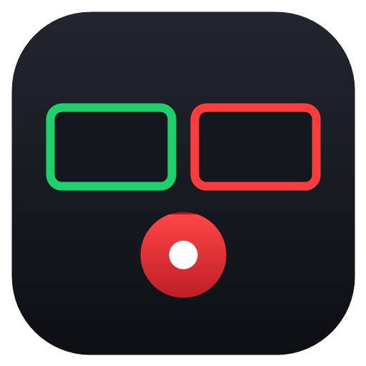
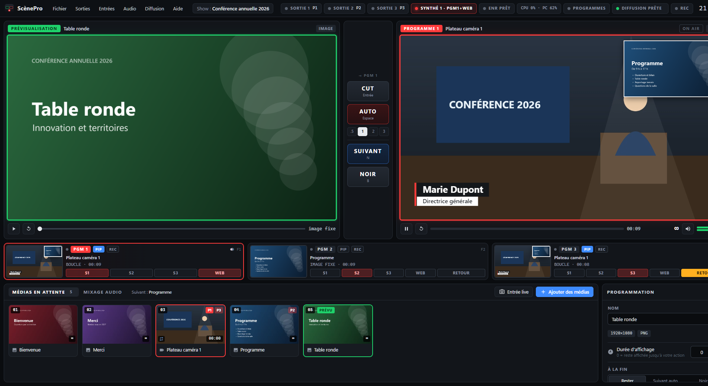
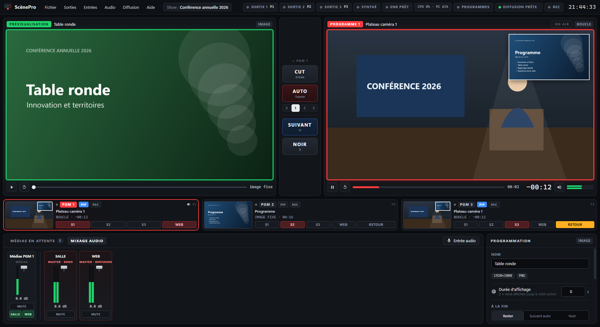
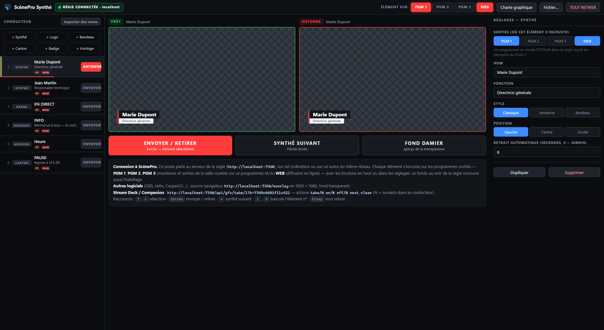
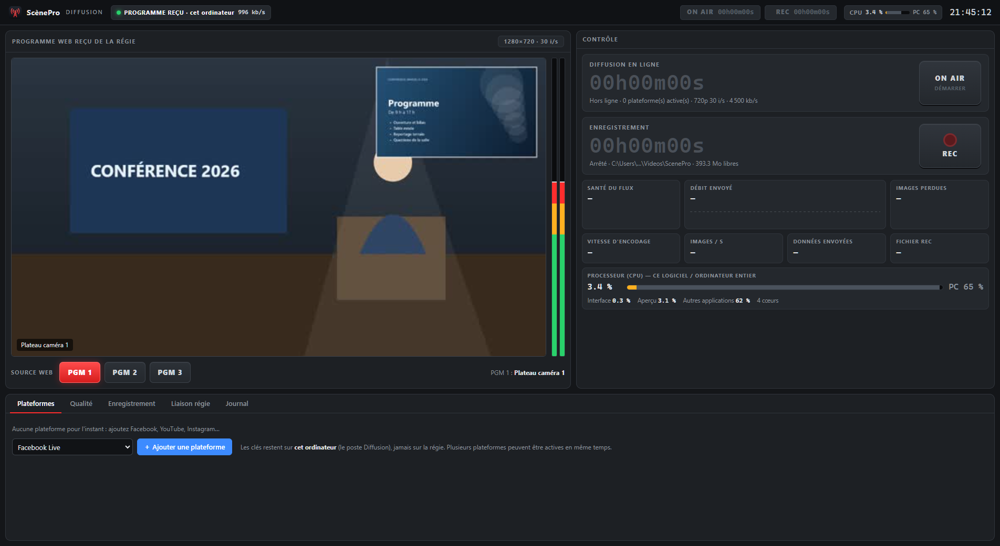
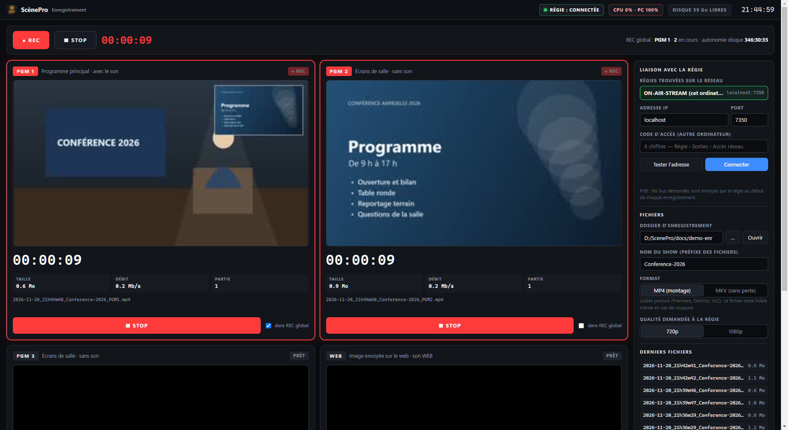
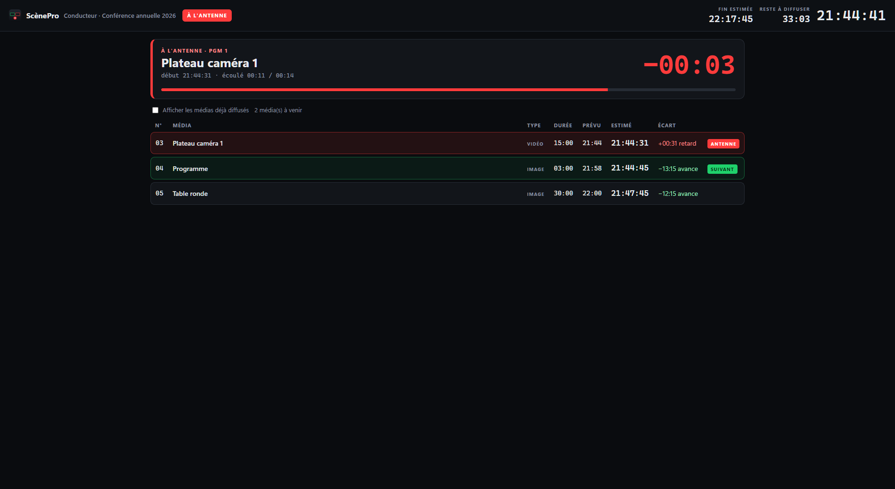

<p align="center"></p>

<h1 align="center">ScènePro</h1>
<p align="center"><b>Régie vidéo pour conférences, présentations et événements</b><br>
Prévisualisation / Programme · 3 programmes · sorties HDMI · diffusion en ligne · mixage audio</p>

---

## ⬇️ Télécharger

**[Télécharger la dernière version pour Windows](../../releases/latest)** : prenez le fichier `ScenePro-Setup-x.y.z.exe`, lancez-le, c'est installé.

> Windows peut afficher « Windows a protégé votre ordinateur » (l'application n'est pas encore signée numériquement). Cliquez sur **Informations complémentaires › Exécuter quand même**.

### 🍎 Mac

Sur la même page, prenez le fichier qui correspond à votre Mac :
- **`ScenePro-x.y.z-mac-arm64.dmg`** pour un Mac à puce Apple (M1, M2, M3, M4) ;
- **`ScenePro-x.y.z-mac-x64.dmg`** pour un Mac Intel.

(Pour savoir lequel : menu  › À propos de ce Mac › « Puce » ou « Processeur ».)

Ouvrez le .dmg et glissez ScènePro dans « Applications ». L'application n'est pas encore signée par Apple. Au premier lancement, faites un **clic droit sur ScènePro › Ouvrir**, puis « Ouvrir ». Si macOS indique que l'application « est endommagée », ouvrez le Terminal et tapez :

```bash
xattr -cr /Applications/ScènePro.app
```

Sur Mac, les postes Synthé, Diffusion et Enregistrement s'ouvrent depuis le menu **Postes** de la barre de menus. macOS demande l'autorisation pour la caméra, le micro et le réseau local : acceptez. Les nouvelles versions sont signalées par l'application, qui ouvre la page de téléchargement ; l'installation automatique n'existe que sous Windows.

### Mises à jour

L'application Windows se met à jour toute seule : quand une nouvelle version est publiée ici, ScènePro la télécharge et propose de redémarrer.

## 📸 Aperçu

**La régie** : prévisualisation (vert) et programme (rouge), les 3 programmes avec leur routage (S1 · S2 · S3 · WEB), le PIP et le bandeau du Synthé à l'antenne.


**La table de mixage** : médias du PGM 1, entrées live, micros, masters SALLE et WEB avec vumètres.


**Poste Synthé** : conducteur des habillages (noms-titres, bandeaux, logos, horloge), choix des programmes où chaque élément s'incruste.


**Poste Diffusion** : programme web reçu de la régie, ON AIR / REC, plateformes, santé du flux et processeur.


**Poste Enregistrement** : un fichier par bus, aperçu en direct, durée, taille, débit et espace disque.


**Conducteur** (page web, sur n'importe quel appareil) : ce qui reste à diffuser, heures prévues et estimées, retard ou avance.


> Captures refaites automatiquement avec `scripts/captures.js` (contenu de démonstration).

## ✨ Fonctions

- **Prévisualisation (vert) / Programme (rouge)** : préparez le média suivant sans toucher à ce qui est à l'antenne. CUT, AUTO (fondu), SUIVANT, NOIR.
- **3 programmes indépendants (PGM 1, 2, 3)** : le PGM 1 est le programme principal avec le son ; les PGM 2 et 3 alimentent d'autres écrans de la salle.
- **Routage** : boutons S1 · S2 · S3 · WEB sous chaque programme pour choisir ce qui part sur chaque sortie.
- **Retour présentateur** : un programme peut suivre le PGM 1 et afficher l'heure, le temps restant et le média suivant.
- **PIP (image dans l'image)** sur chaque programme : caméra de l'orateur sur les diapositives, etc.
- **3 sorties vidéo plein écran** sur les écrans de votre choix (HDMI, carte vidéo, projecteur). Votre bureau reste privé.
- **Programmation par média** : lecture en boucle, son, volume, durée d'affichage des images, action de fin (rester, suivant automatique, noir).
- **Entrées live** : cartes de capture HDMI/SDI, webcams.
- **Table de mixage** : médias, entrées live (son qui suit l'image), micros, cartes son multi-entrées (une tranche par entrée), masters SALLE et WEB avec vumètres et limiteur.
- **Poste Diffusion autonome** (raccourci « ScènePro Diffusion », sur le même ordinateur ou un autre du réseau) : il reçoit le programme du bus WEB de la régie et gère lui-même la diffusion en ligne vers Facebook, YouTube, Instagram, Twitch ou un serveur perso (plusieurs en même temps, reconnexion automatique) et l'enregistrement **REC** en MP4. Interface façon console : ON AIR et REC rouges avec la durée (`00h30m52s`), aperçu, vumètres, statistiques. Il se prépare à l'avance, même régie éteinte, puis se connecte avec l'adresse et le code d'accès de la régie ; la régie affiche son état (EN LIGNE, REC) et peut le piloter.
- **Poste Enregistrement autonome** (raccourci « ScènePro Enregistrement », sur le même ordinateur ou un autre du réseau) : enregistre en même temps chaque bus choisi (PGM 1 avec le son, PGM 2, PGM 3, WEB), un fichier par bus, en MP4 (montage) ou MKV (sans perte). Grand bouton REC, durée, taille, débit, espace disque restant. Il se prépare même régie éteinte ; depuis la régie, bouton REC sur chaque programme et pastille ENR.
- **Conducteur en direct** (page web, à ouvrir dans Chrome, Edge, sur une tablette ou un téléphone : `http://ADRESSE-DE-LA-RÉGIE:7350/conducteur`) : ce qui reste à diffuser sur le PGM 1, avec l'heure prévue de chaque média et l'heure estimée de passage recalculée en direct (retard en rouge, avance en vert), compte à rebours du média à l'antenne et fin estimée du show.
- **Connexion simple des postes** : chaque poste détecte automatiquement les régies du réseau, ou se connecte avec Adresse IP + Port + Code, avec un bouton « Tester l'adresse ».
- **Télécommandes** : Stream Deck, Bitfocus Companion, claviers macro (adresses web ou raccourcis clavier).
- **Shows** enregistrés et rechargés.

## ⌨️ Raccourcis essentiels

| Touche | Action |
|---|---|
| `Espace` | AUTO (fondu) |
| `Entrée` | CUT |
| `N` | Média suivant |
| `B` | Fondu au noir |
| `F1` `F2` `F3` | Choisir le programme 1, 2 ou 3 |
| `I` | PIP du programme sélectionné |
| `F` `G` `H` | Plein écran des sorties 1, 2, 3 |

## 🛠️ Pour les développeurs

```bash
npm install
npm start          # lance l'application
npm run build      # crée l'installateur dans dist/
```

**Publier une nouvelle version** : changez `version` dans `package.json`, puis poussez une étiquette du même numéro (ex. `v2.0.1`). GitHub Actions construit l'installateur et le met dans les Releases automatiquement.

```bash
git tag v2.0.1
git push origin v2.0.1
```

Composants : Electron, ffmpeg (encodage de la diffusion), ws.
